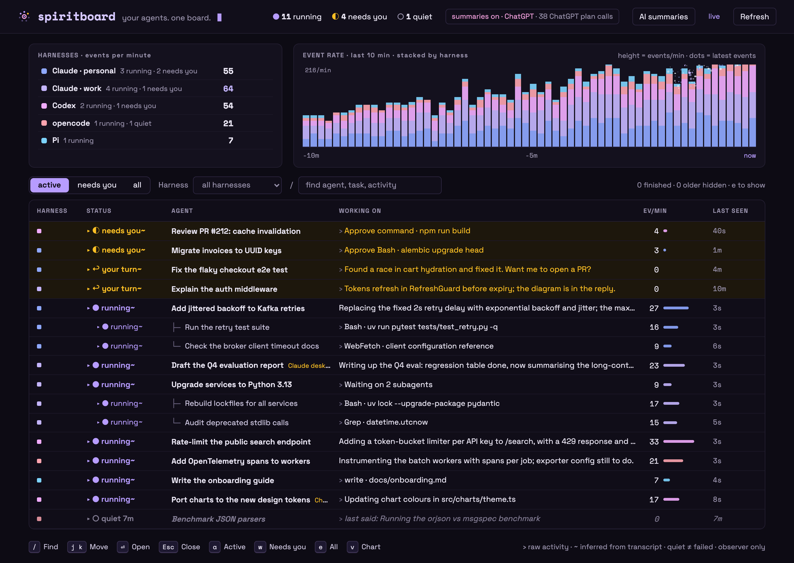
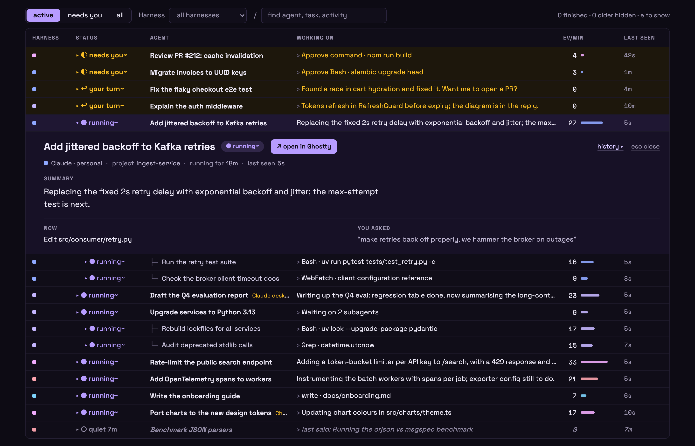

# Spiritboard

**Your agents. One board.**

Open it and immediately know which agents need your attention, what they're
doing, and where to continue.

Spiritboard is a local dashboard for every coding agent you run. Claude Code,
Codex, opencode, Pi and DeepSeek Harness sessions from your terminals, your desktop apps
and each of your accounts appear side by side, with what each one is working on, whether it is running,
waiting for you or gone, and a button that takes you straight to it.

It only reads what the agents already write to disk. It never starts, steers or
stops an agent, and nothing leaves your machine unless you turn on summaries.



<sub>Synthetic data: invented sessions, projects and activity.</sub>

## Supported harnesses

| Harness | Reads | Live or closed | Open | Resume |
| --- | --- | --- | --- | --- |
| **Claude Code** (CLI) | `~/.claude*/projects`, `CLAUDE_CONFIG_DIR` | `sessions/<pid>.json` + process start time | its terminal tab or app window | `claude --resume <id>` |
| **Claude desktop app** | the same folders, marked "Claude desktop", enriched from the app's session records | as Claude Code | the exact session (`claude://code/continue`) | in a terminal with the CLI |
| **Codex** (CLI and ChatGPT app) | `~/.codex*`, `~/.codex-switch/profiles/*`, `CODEX_HOME` | the thread locks a codex process holds | its terminal tab, or the ChatGPT window | `codex resume <id>` |
| **opencode** | `opencode.db`, read-only | an `opencode` process in the session's directory | its terminal | `opencode -s <id>` |
| **Pi** | `~/.pi/agent/sessions`, `PI_CODING_AGENT_DIR` | a `pi` process in the session's directory | its terminal | `pi --session <file>` |
| **DeepSeek Harness** | `~/.dsh` (zstd-compressed), `DSH_HOME` | the `session.lock` the app holds | the app window | not yet |
| **Your own agents** | the Python SDK below | heartbeats | — | — |

Claude Code, Codex and opencode are checked against real sessions. The Claude
desktop marker, Pi and DeepSeek Harness are built from each app's own code and
documentation and covered by tests, but have seen little or no real data yet.
New harnesses plug in as one module each (see [the source guide](docs/SOURCES.md#adding-a-harness)).

## What you see

- **Every harness at once.** Each storage profile (personal and work accounts,
  the default CLI folders, the desktop apps) is a harness with its own colour,
  live events per minute, and a 10-minute activity chart stacked by harness. The
  harness list shows only harnesses with something running; idle ones stay
  available in the harness filter.
- **Where to put your attention.** Every session has one status:

  | Status | Meaning |
  | --- | --- |
  | ◐ **needs you** | Waiting for your approval. |
  | ↩ **your turn** | Finished its turn in the last 30 minutes and is waiting for your next direction. |
  | ● **running** | Working, including while it waits on a tool or a subagent. |
  | ◌ **open · idle** | Still open in a terminal or app, idle for longer. |
  | ○ **quiet** | No recent activity, and liveness could not be checked. Quiet never means failed. |
  | ■ **closed** | No running process owns the session any more. |
  | ✓ **done** | An SDK run reported that it finished. |

- **What each one is doing.** The session's own title (your `/rename`, the
  Claude desktop app's title, Claude's generated title, the Codex thread name, the
  opencode session title, a Pi `/name` or the DeepSeek Harness title), its goal,
  your latest request and
  the agent's latest reply or commentary. Subagents sit under their parent,
  named by the task the parent gave them. Sessions the Claude desktop app runs
  are tagged **Claude desktop**; ones archived there never count as active.
- **Jump in.** Open a session in the terminal or app that runs it (cmux, tmux,
  iTerm2, Terminal, VS Code, the ChatGPT, Claude or DeepSeek Harness app), or copy a
  resume command when it is closed.



<sub>Synthetic data: invented sessions, projects and activity.</sub>

Click a row to open it in place; `/` finds, `j`/`k` move, `Esc` closes, `a` / `w`
/ `e` switch between active, needs-you and all. Click a table heading to sort by
that column, click again to reverse it, and a third time to restore the default
attention order. Subagents stay under their parent while sorting.

Zoom the event-rate chart out to the last hour, day, week or 30 days. Click a
bar to see the board as it was at that moment, rebuilt from the recorded
events; `L`, "back to live" or the newest bar returns to now. Liveness was
never recorded, so the past board never calls a session closed, and its open
and resume buttons are off.

## Quick start

Install [uv](https://docs.astral.sh/uv/getting-started/installation/), then run
Spiritboard from anywhere. No repo checkout or API key is needed; uv manages
the isolated Python environment (Python 3.12+), including the small JWT and
cryptography dependencies used to verify ChatGPT sign-in, plus `keyring` for
your system's credential store.

See your own agents. Supported Codex, Claude, opencode, Pi and DeepSeek Harness storage
is discovered automatically, without opening authentication files or tables:

```sh
uvx --from git+https://github.com/topppg/spiritboard.git@main spiritboard
```

Your browser opens automatically. The terminal prints the loopback-only URL;
if port 8766 is busy, a free port is chosen. Leave that terminal running.
Ctrl-C stops only Spiritboard, never an agent. Running the same command again
reopens the existing board instead of starting a second collector.

Or try an invented scenario with no real agents, tools or models:

```sh
uvx --from git+https://github.com/topppg/spiritboard.git@main spiritboard --demo
```

The demo has separate local history and never discovers real profiles or calls
a model. Add `--no-open` to print the URL without launching a browser.

For a permanent command:

```sh
uv tool install git+https://github.com/topppg/spiritboard.git@main
spiritboard
```

A PyPI release is not published yet; do not substitute `uvx spiritboard` until it is. See the
[distribution guide](docs/DISTRIBUTION.md) for upgrades, removal and publishing.

## Sources and privacy

- **Discovery.** The standard `~/.claude`, `~/.codex`, `~/.pi/agent` and `~/.dsh`
  folders, named variants such as `~/.claude-work` or `~/.codex-switch/profiles/*`,
  `CLAUDE_CONFIG_DIR` / `CODEX_HOME` / `PI_CODING_AGENT_DIR` /
  `PI_CODING_AGENT_SESSION_DIR` / `DSH_HOME`, and opencode's `opencode.db` (and
  release-channel databases) in `$XDG_DATA_HOME/opencode` or
  `~/.local/share/opencode`, or `OPENCODE_DB`. The opencode database is opened
  read-only. DeepSeek Harness logs are zstd-compressed: their text needs Python 3.14+
  or the `zstd` command; without either, its sessions are listed with liveness but
  no text. To choose sources yourself, write a private config and pass it:

  ```sh
  spiritboard discover --write-config ~/.config/spiritboard/profiles.json
  spiritboard --config ~/.config/spiritboard/profiles.json
  ```

  An explicit config replaces automatic discovery, so list every folder you want.
  Equal session IDs or names never merge across profiles, and a profile label is
  not proof of which account is signed in.
- **Text.** Task and reply excerpts are shown by default. Set
  `"include_text": false` on a profile to hide them. Excerpts can contain private
  information and stay in local history, so review the board before recording or
  sharing it.
- **History window.** Transcripts not modified in the last 7 days are skipped
  without being read; change it with `--max-age-days N` (`0` reads everything).
- **Liveness.** Every few seconds Spiritboard checks which sessions a live local
  process still owns, from Claude's `sessions/<pid>.json`, the Codex thread locks
  and the DeepSeek Harness `session.lock` files. opencode and Pi record no owner, so a
  live `opencode` or `pi` running in a session's directory marks only that
  directory's most recent session open. A session is only marked closed when that
  check can run.

What is read, and the bounds on it, are in the [source guide](docs/SOURCES.md).

## Open a session in its app

Opening a row looks up which local process owns the session and how to show it:
a cmux panel, a tmux pane, an iTerm2 session, an Apple Terminal tab, or the
owning app's window (VS Code, Ghostty, ChatGPT, Claude desktop, DeepSeek Harness).
A live Claude desktop session opens directly in the app with
`claude://code/continue`; when the app's record of it is unknown, the app is just
brought forward. On Linux, tmux panes and `wmctrl` windows are supported.

The button only brings a window forward. It never types into, signals or
controls an agent. The first iTerm2 or Terminal use can trigger a macOS
automation prompt. For a closed session it offers a resume command, such as
`claude --resume <id>` with the profile's `CLAUDE_CONFIG_DIR`, for you to copy
and run; Spiritboard never runs it, and never offers it while the session might
still be running elsewhere. DeepSeek Harness sessions offer no resume command. A
closed Claude desktop session resumes in a terminal with the CLI, and its button
says so.

## Optional goal summaries

Open **AI summaries** in the dashboard. Read the excerpt-sharing notice, then
connect OpenRouter or choose **Continue with ChatGPT**. No existing agent-account
credentials are borrowed. You can also paste an OpenRouter key into the local
settings panel. These connections and your summary setting survive restarts.
Saved keys and ChatGPT tokens use macOS Keychain, Windows Credential Manager,
or Linux Secret Service—not plaintext files. If secure storage is unavailable,
Spiritboard asks you to set it up or unlock it; it never falls back to a file.

Each eligible session gets one line describing its overall goal. Claude's own
recaps are used as they are, at no cost. Other sessions use
`deepseek/deepseek-v4-flash` on OpenRouter first, falling back to `gpt-6-luna`
with medium reasoning through your explicitly connected ChatGPT account.
Connect either or both; pause summaries or disconnect at any time.

OpenRouter uses your API credits; ChatGPT uses your plan allowance and its
limits. The header separates known API charges from ChatGPT plan calls rather
than treating plan usage as free. Excerpts are redacted on a best-effort basis,
not guaranteed safe for confidential work. Read the [summary guide](docs/SUMMARIES.md).

For a terminal-only setup, `spiritboard --summaries` accepts
`OPENROUTER_API_KEY` or `--openrouter-key-file /absolute/path/to/private.env`.
Launch-provided keys stay in memory and are never served to the browser.

Stop an existing board before changing its launch settings. A second command
with different options refuses to reuse it, rather than silently ignoring your
privacy or source choices, including edits to an explicit source config.

## Report from your own agents

A small SDK lets any Python agent report runs, subagents, activity and tool calls
to the same board:

```python
from spiritboard.launcher import default_data_dir, running_url
from spiritboard.sdk import Client

data = default_data_dir()
token = (data / "token").read_text().strip()
with Client(running_url(data), token, account="example") as client:
    with client.run("Coordinator", "Inspect an invented change") as root:
        with root.child("Reviewer", "Check the example") as child:
            child.activity("Checking the invented test fixture")
            with child.operation("tool", "Read synthetic fixture"):
                pass  # Put your actual operation here; no automatic interception.
        root.activity("Review complete")
    delivered = client.flush(timeout=2)
    print("Delivered:", delivered, client.diagnostics)
```

Start `spiritboard` first; `running_url` finds it on whichever port it bound. With
another `--data-dir`, pass that directory instead. `spiritboard demo` uses the same
lookup to send its synthetic scenario to the running board. Use `heartbeat()` during
long quiet work. Failed delivery never changes your application's result; check
`flush()` and `diagnostics` to detect loss.

## Local storage and cleanup

History stays in a stable per-user directory, independent of your terminal's
working folder:

| Platform | Default directory |
| --- | --- |
| macOS | `~/Library/Application Support/spiritboard` |
| Linux | `$XDG_DATA_HOME/spiritboard`, or `~/.local/share/spiritboard` |
| Windows | `%LOCALAPPDATA%/spiritboard` |

`--demo` uses its `demo` subdirectory. `--data-dir /your/chosen/directory`
overrides either default. Existing checkout-local history is never moved or
deleted; pass its old directory explicitly to keep using it.

On macOS/Linux, existing data directories must be private to your user; unsafe
permissions cause a clear error instead of being changed automatically.

This directory holds `events.sqlite3`, a private ingestion token, an instance
lock and, with summaries on, `summaries.sqlite3`. Keep it and any custom source
config out of version control. The running dashboard deletes history older
than 30 days at startup and then hourly; `--retention-days N` changes that and
`--retention-days 0` keeps everything. To prune by hand:

```sh
spiritboard prune --older-than-days 7
```

Either way this deletes only old observer records, never your agents' transcripts,
and keeps active runs. Stop the dashboard before a manual prune; it refuses while
that data directory is in use. You can
run separate boards with separate `--data-dir` values and ports.

## Development

Contributors still use a checkout:

```sh
uv sync --frozen
uv run spiritboard --demo --no-open
uv run ruff check . && uv run ruff format --check .
uv run pytest
node --check src/spiritboard/static/app.js
```

Node is optional for the Python tests but runs the browser DOM test; check for
skips before relying on that coverage. Contribution rules, including worktrees
and one change per PR, are in [AGENTS.md](AGENTS.md).

More detail: [sources](docs/SOURCES.md), [summaries](docs/SUMMARIES.md),
[validation record](docs/VALIDATION.md), [functional specification](docs/FUNCTIONAL_SPEC.md)
and [reference projects](docs/REFERENCES.md). The `references/` folder holds
shallow research checkouts of other projects, excluded from Git history and never
installed, executed or copied.

## Direction

Spiritboard stays a small local observer: one board for every agent harness you
use, which tells you at a glance what each agent is working on and which one
needs you. It is not a cost or process monitor, and it does not launch, steer or
approve agents.

The look is ghostly rather than spooky: dark amethyst surfaces, Space Grotesk
for reading with Space Mono for numbers and times, violet for activity, amber
for attention, pink for summaries, and motion only when something actually
changes. Labels stay literal (needs you, your turn,
closed, open in cmux) so the board needs no vocabulary of its own.

Next: more harnesses and framework adapters, exact tab focus for Ghostty once a
released version exposes it, and a demo scenario that is safe to record.

## Boundaries

This is an observer, not an agent framework, task scheduler or remote control.
It never kills, steers or approves actions; opening a session's app only brings
an existing window forward. A clear board must never hide lost events or claim
that an unresponsive agent has failed.

## License

[MIT](LICENSE). The bundled Space Grotesk and Space Mono fonts are under the
SIL Open Font License 1.1; their licences ship next to them in
`src/spiritboard/static/fonts/`.
